# TorqDrop

> Know more about the car before you buy it.

TorqDrop is an Android app for used-car inspection and everyday car diagnostics. It combines a guided inspection checklist, live OBD-II data over Bluetooth, and AI that looks at photos and listens to the engine. Every AI result is a suggestion with its evidence attached; safety warnings come from fixed rules, never from AI.

## Screenshots

**AI engine sound check:** a guided 20-second clip, matched to live rpm from the car.

| Home | Recording, guided | AI verdict |
| :---: | :---: | :---: |
| 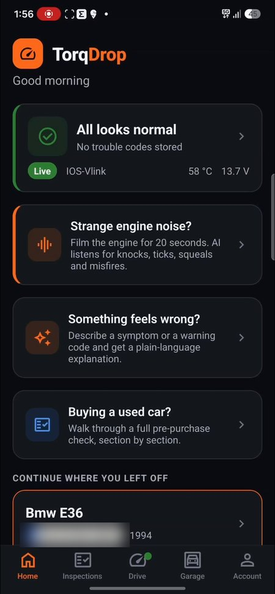 | 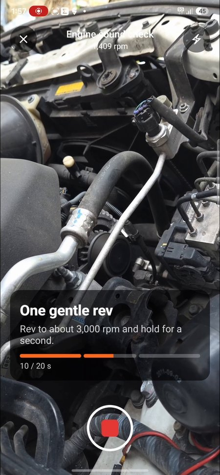 | 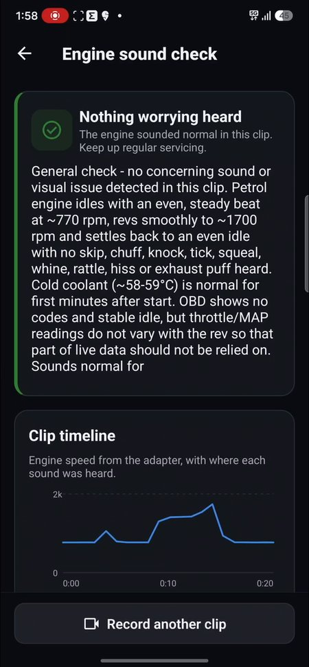 |

**Used-car inspection:** a guided checklist, with AI reviewing every photo.

| Checklist with photos | AI photo review | Review and sign off |
| :---: | :---: | :---: |
| 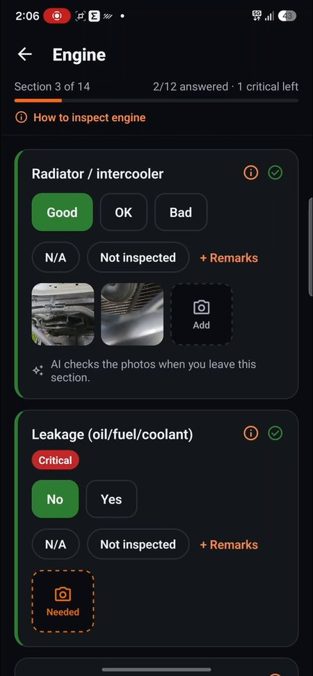 | 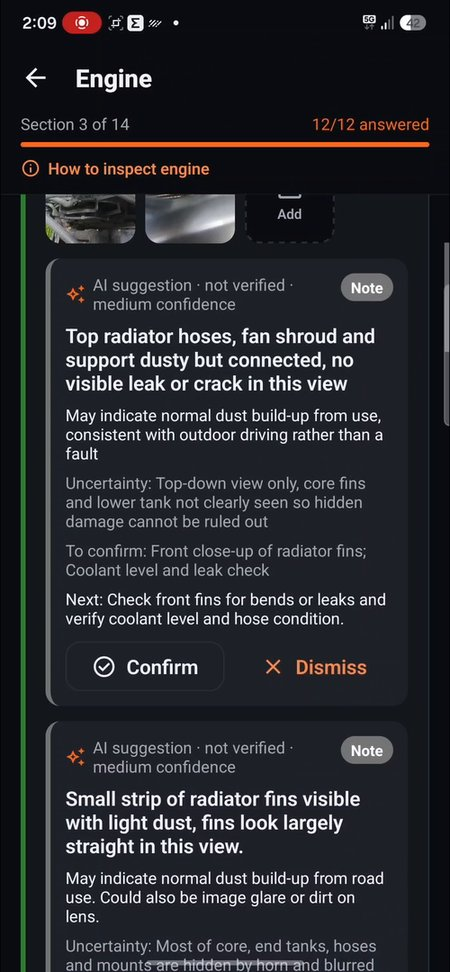 | 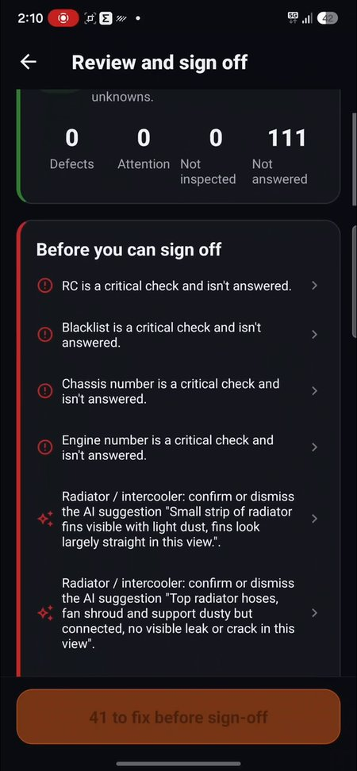 |

**Live diagnostics:** real data from a car over a Bluetooth OBD-II adapter.

| Live data | AI insights | Health check |
| :---: | :---: | :---: |
| 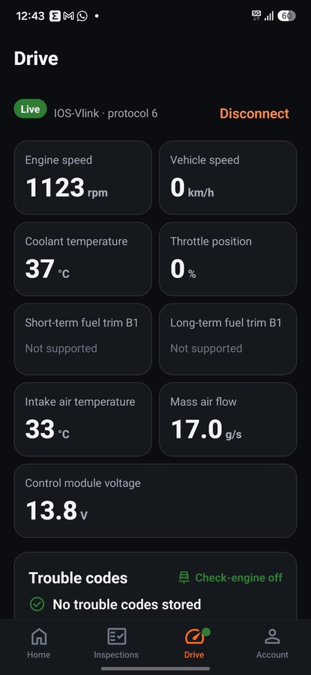 | 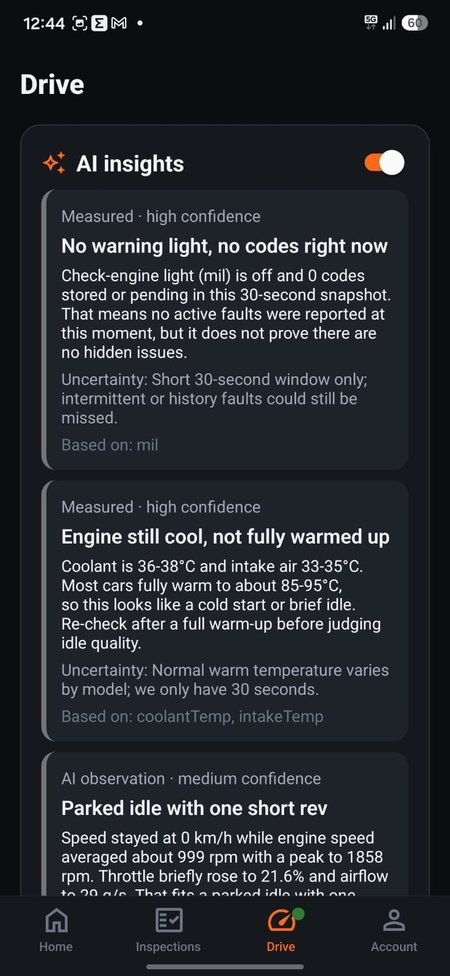 | 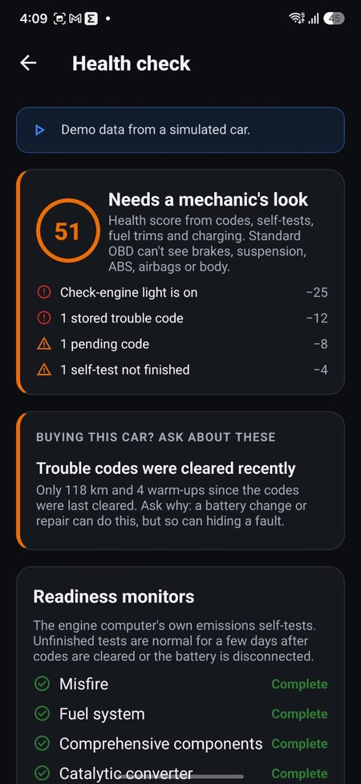 |

| Drive dashboard | All sensors |
| :---: | :---: |
| 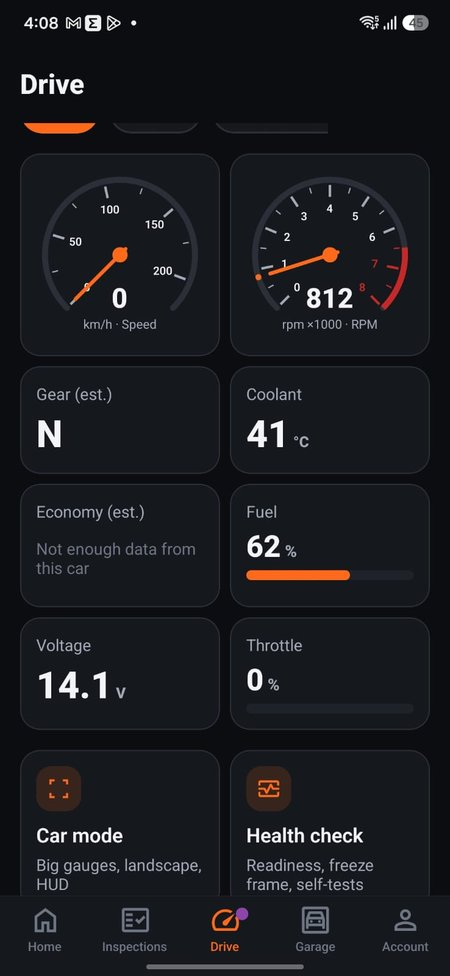 | 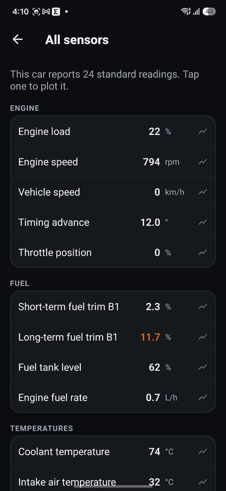 |

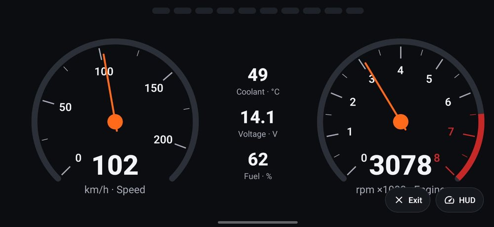

*Car mode: big landscape gauges, with a mirrored HUD view for the windscreen.*

## Features

**Engine sound check.** Record a 20-second guided video of the engine: idle, one gentle rev, back to idle. A multimodal model listens for knocks, ticks, squeals, whines and misfires, and watches for smoke and leaks. When an OBD adapter is connected, the app records rpm, load, throttle and fuel trims alongside the clip, so each sound is matched to what the engine was doing. Results show on a timeline over the rpm trace. The clip is deleted from the server right after analysis.

**Pre-purchase inspection.** A guided 200-point checklist, section by section, with a map of where each check is on the car. AI reviews photos for repaints, dents, leaks and flood signs; the inspector confirms or dismisses every suggestion. It reads RC and insurance documents, works offline, and ends in a signed report shared as a link or PDF.

**OBD-II diagnostics.** Connects to Bluetooth LE ELM327-compatible adapters. Live gauges, trouble codes in plain language, freeze frame and Mode 06 data, readiness monitors, automatic trip logging with fuel economy, and a garage with service reminders. Cars are matched by VIN, or by ECU fingerprint when the car doesn't report a VIN.

**No adapter?** A built-in simulated car runs every OBD feature with clearly labelled demo data.

## How AI helps

Most people can't judge a car's condition. A buyer doesn't know a repainted panel when they see one, and an owner hears a new noise but can't say whether it's a loose heat shield or a failing bearing. Mechanics can, but they aren't standing next to you when you need them. TorqDrop uses AI to give that first expert opinion: what it sees or hears, how serious it might be, and what to check next.

| Where | What the AI does for the user |
| --- | --- |
| **Engine sound check** | Watches and listens to a 20-second engine video. Names the sounds it hears (knock, tick, squeal, whine, misfire, exhaust leak…) with the time each one happens, judges whether the idle is steady, notes smoke or leaks it can see, and explains what each finding usually means. With OBD data recorded alongside, it can tell a sound that rises with rpm (engine) from one that doesn't (accessory or body). |
| **Inspection photos** | Reviews each photo against the checklist item it was taken for: paint shade mismatch, uneven panel gaps, dents, rust, oil leaks, worn tyres, flood marks. |
| **Documents** | Reads the RC and insurance papers and fills in registration, owner count, fuel, validity dates and more, so the inspector checks rather than types. |
| **Live engine data** | Looks at a snapshot of live OBD readings and points out what's unusual, such as lean fuel trims or a slow-warming engine, in plain language. |
| **Trouble codes and symptoms** | Explains warning codes and symptoms the owner describes: likely causes, how urgent it is, and what to ask a mechanic. |
| **Inspection summary** | Turns a finished inspection into an overview a buyer can read, with the issues that matter most first. |

### Built so AI can't mislead

A wrong answer about a car can cost money or be unsafe, so the AI is boxed in:

- **Safety warnings never depend on AI.** Rules in `lib/diagnostics/safety-rules.ts` decide when to say "stop driving" (overheating, a flashing misfire light, low oil pressure…). The model can raise the urgency, but never lower it below what the rules say.
- **Evidence first.** Every finding is tied to the photo, sound time or reading behind it. The inspector confirms or dismisses each photo suggestion, and nothing goes in a report unconfirmed.
- **Honest about uncertainty.** Each finding has a confidence level. A noisy or badly framed clip gets "couldn't hear clearly, record again", not a guess. The app never says a car is safe or defect-free.
- **Validated output.** Replies must match a strict JSON schema, then pass Zod validation in `lib/schemas/`. Anything that doesn't parse, refers to a reading that wasn't sent, or claims a time outside the clip is dropped.

## How we use the Meta Model API

All AI runs on [Meta's Model API](https://dev.meta.ai/) (`https://api.meta.ai/v1`, OpenAI-compatible), through one small client in `functions/src/shared/meta-client.ts`.

- **Muse Spark 1.3** (`muse-spark-1.3`) handles images and text: inspection photos, RC and insurance documents, live OBD snapshots, trouble codes and inspection summaries. Images go in as `image_url` parts, and replies use native `json_schema` structured output.
- **Muse Spark 1.2** (`muse-spark-1.2`) handles the engine sound check, because it takes video **with its audio track** in a single request (`video_url`, sampled at 2 frames a second). We picked 1.2 over 1.3 here because Meta's docs note 1.3's audio understanding is reduced. The clip goes in together with the car's details, the owner's concerns and the per-second OBD trace, so the model can reason about sound, picture and engine data at once.

**Why it matters.** The engine sound check only works because one model can see, hear and read numbers together. Without it, we'd need a separate audio classifier, an image model and our own logic to fuse them, and still couldn't explain the result in plain language. Muse Spark's multimodal input and structured output let a small team ship a mechanic-style "listen to it" check in a phone app. Vision and document reading do the same for the inspection: hours of typing and second-guessing become a quick confirm-or-dismiss.

**How it's run safely and cheaply:**
- The API key stays on the server (Firebase Secret Manager). The app never calls Meta directly; it goes through Cloud Functions that require sign-in and App Check.
- Free text from users is stripped of phone numbers, email addresses and registration numbers before it's sent.
- Engine clips are uploaded to Cloud Storage, sent once, and deleted straight after analysis.
- Each user has daily limits (for example 10 engine checks and 20 code explanations a day), and every call's tokens and cost are logged to an `aiUsage` collection.
- Bad replies are retried once, then shown as "AI unavailable" with the rule-based safety advice still in place.

## Architecture

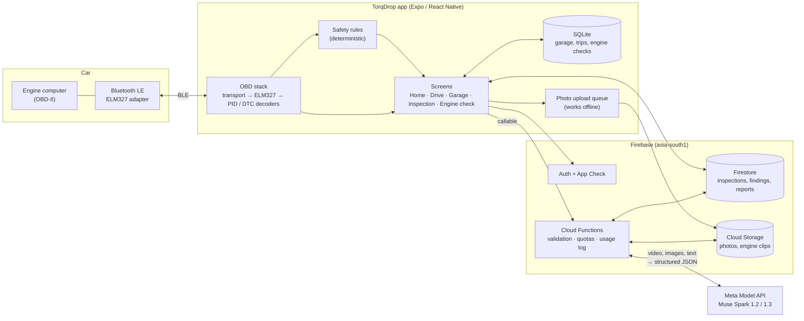

**Engine sound check, end to end:**

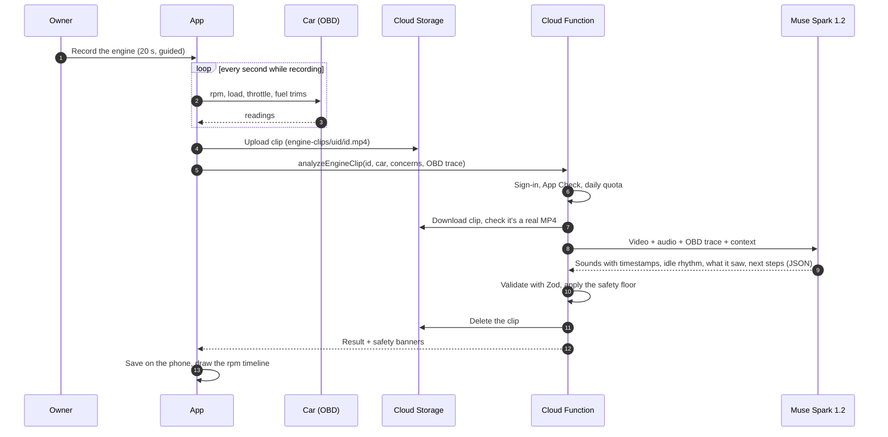

**Design choices:**
- **Offline first.** OBD runs entirely on the phone, so live data, trouble codes, trips and the garage work with no network. Inspections use Firestore's offline cache, and photos wait in a local queue until there's a signal.
- **AI only on the server.** The app never holds the Meta API key. Every AI call goes through a Cloud Function that checks sign-in and App Check, applies a per-user daily quota, and logs tokens and cost.
- **Rules before AI.** Deterministic rules (`lib/diagnostics/safety-rules.ts`) produce the safety warnings. Model output is validated against shared Zod schemas (`lib/schemas/`), and the model can only raise urgency.
- **One OBD stack, any transport.** The same session and decoders run over Bluetooth, over a simulated car for demos, and over scripted adapter replies in the unit tests.
- **Minimal data kept.** Engine clips are deleted after analysis. Engine check results, trips and the garage stay on the phone; inspections, reports and the account live in the cloud.

| Layer | What's there |
| --- | --- |
| OBD | `lib/obd/`: BLE and mock transports, ELM327 session, PID and DTC decoding, live polling, trip recorder, health score, battery and performance tests |
| Diagnostics | `lib/diagnostics/`: safety rules, trouble-code database, evidence engine, inspection checklists |
| Local data | `lib/db/`: SQLite with migrations (vehicles, trips, maintenance, reminders, engine checks) |
| Cloud | `lib/firebase/`: auth, App Check, inspections, upload queue, AI calls |
| Functions | `functions/src/`: `analyzeEngineClip`, `analyzePhotoEvidence`, `analyzeSectionPhotos`, `scanDocument`, `analyzeLiveSnapshot`, `explainDtc`, `analyzeSession`, `finalizeReport`, `createReportLink`, `reportPage`, `verifyPurchase`, `deleteAccount` |
| Security | `firestore.rules`, `storage.rules`: owner-only access; only the server can write credits, payments, reports, share links and AI usage |

### Tech stack

- **App:** Expo SDK 58, React Native 0.88, Expo Router, TypeScript, `react-native-ble-plx`, `expo-camera`, `expo-sqlite`.
- **Backend:** Firebase (Auth, Firestore, Storage, Cloud Functions 2nd gen, App Check, Hosting).
- **AI:** Meta's OpenAI-compatible Model API, called only from Cloud Functions. Model output is validated with Zod; anything malformed is dropped, and drive-safety advice can only be raised by the model, never lowered below what the rules say.

| Folder | What's there |
| --- | --- |
| `app/` | Screens (Expo Router) |
| `components/` | UI components |
| `lib/obd/` | BLE transport, ELM327 session, PID and DTC decoding, simulated car, trip recorder |
| `lib/diagnostics/` | Rule-based safety checks |
| `lib/schemas/` | Zod schemas shared by the app and the functions |
| `functions/src/` | Cloud Functions: photo, document, live-data and engine-sound analysis, reports, billing |
| `tests/` | Unit tests (decoders, safety rules, schemas) and Firestore/Storage rules tests |

## Running it yourself

You need Node 22, an Android phone (BLE needs a development build, not Expo Go), and your own Firebase project on the Blaze plan.

1. `npm install` and `npm --prefix functions install`.
2. Create a Firebase project. Enable Phone and Email-link sign-in, Firestore and Storage in `asia-south1`, and App Check with Play Integrity. Add an Android app with package `com.torqdrop.connect` (or change it in `app.json`) and save its `google-services.json` in the project root.
3. Copy `.firebaserc.example` to `.firebaserc` and set your project ID.
4. Set the AI key and deploy the backend:
   ```bash
   npx firebase functions:secrets:set META_API_KEY
   npx firebase deploy --only functions,firestore,storage,hosting
   ```
5. Register an App Check debug token for development and put it in `.env` (see `.env.example`).
6. Build and run on a phone: `npx expo run:android`, or `npx eas-cli@latest init` then `npx eas-cli@latest build --profile development --platform android`.

### Tests

```bash
npm test            # unit tests
npm run test:rules  # Firestore and Storage rules, in the Firebase emulator
npx tsc --noEmit && npx expo lint
```

## Disclaimer

TorqDrop is an inspection assistant, not a mechanic. AI findings are suggestions to help decide what to check, and the app never claims a car is safe or free of defects.
